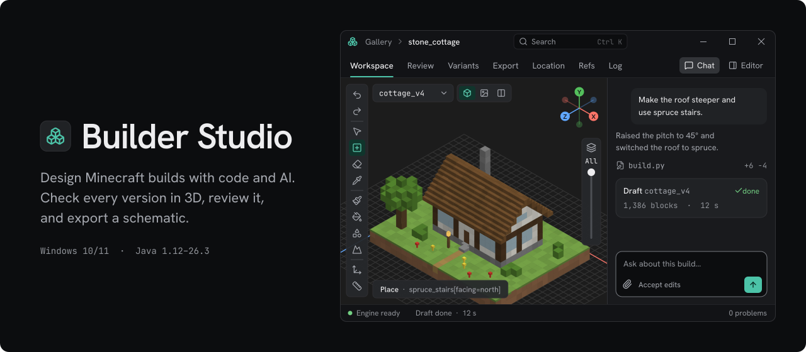
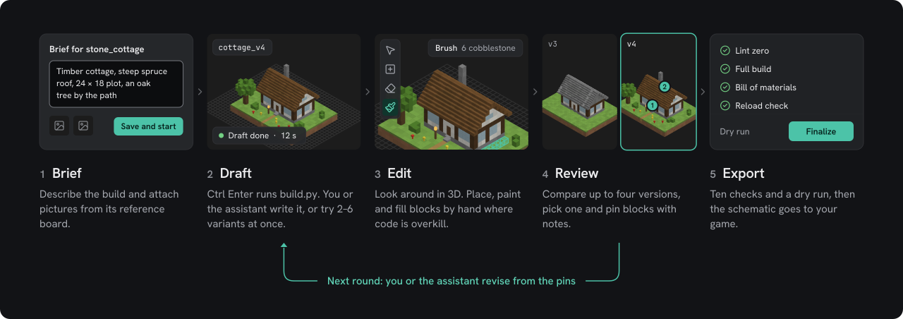

<p align="center">
  
</p>

<p align="center">
  <a href="https://github.com/ModerNik/builder-studio/releases/latest"></a>
  <a href="src/renderer/src/pages/docs/content/README.md"></a>
  <a href="LICENSE"></a>
</p>

<p align="center">
  <b>Builder Studio</b> is a Windows desktop workstation for designing Minecraft builds with code and AI.<br>
  Describe a build, inspect and edit it in 3D, mark what to change, and export a ready-to-paste schematic.
</p>

<p align="center">
  <a href="#how-it-works">How it works</a> ·
  <a href="#features">Features</a> ·
  <a href="#get-started">Get started</a> ·
  <a href="#documentation">Documentation</a> ·
  <a href="#development">Development</a> ·
  <a href="#contributing">Contributing</a> ·
  <a href="#license">License</a>
</p>

---

## How it works

<p align="center">
  
</p>

Every build is a small Python script executed by a dedicated build engine. Because the geometry lives in code, builds stay exact, editable, and repeatable: change a roof pitch, wall height, or material palette and regenerate in seconds.

You can write and edit the script yourself, collaborate with an AI assistant directly inside the app, or connect an external agent over MCP. Builder Studio is where you inspect every version in 3D, make hand edits, compare drafts, record feedback, and export safely to your game.

---

## Features

### 🧱 Live 3D view and hand editor

Inspect every version in a live Three.js 3D viewport rendered with your own Minecraft textures, complete with an interactive axis gizmo, a vertical Y-level clip slider to see inside, and preview render sheets. Switch to the **Editor** panel to modify blocks directly by hand — place, erase, pick, brush, paint, fill, stamp shapes, sculpt terrain, transform selections, measure with the ruler, and undo or redo every edit. Compare any two versions side by side or highlight added, removed, and changed blocks in 3D.

### 🤖 Built-in AI assistant (optional)

Work with **Claude** (using your own Anthropic API key), **Codex** (ChatGPT sign-in), or a local **Ollama** model in a docked side panel. The assistant edits build scripts, runs drafts, and displays results directly in the transcript. Every action is gated by clear permission modes (`Manual`, `Accept edits`, `Auto`, `Plan`), interactive approval cards, per-build `Always` rules, and turn-level file rewind checkpoints. AI is completely optional — every other feature works without it.

### 📌 Visual review rounds

Compare up to four versions side by side, pick a favourite, approve finished parts so later rounds preserve them, and drop numbered pins directly on blocks or preview sheets with notes. Saving a round writes structured feedback (`round_N.json` + `DESIGN.md` gist) and sends it straight back to the assistant.

### 🔀 Parallel variants

Explore 2 to 6 directions simultaneously from a single brief or round of feedback. Each lane runs in isolation on its own script copy, and you can send every finished variant into one Review round to pick the winner.

### 🗺️ Fit builds to your world

Pick a Minecraft save in **Build location**, render a top-down map of the area, drag out a footprint with margins, copy `ORIGIN = (x, y, z)`, and export terrain data (`terrain.npz`). World saves are always read through copies — Builder Studio never writes to your Minecraft world.

### 🧩 Parts, checks, and materials

Browse builds by named parts, colour-code or isolate parts in 3D, send selected parts to the assistant with their exact coordinates and code lines, run structural lint checks (floating blocks, missing support, gravity blocks, dark areas, fire risk, invalid states, and more), and inspect full material counts.

### 🎨 Reference board and Labs

Keep a per-build reference board (paste screenshots, drop images, save links and notes, and attach them to prompts) and use **Labs** to explore block palettes, colour gradients with shade checks, kit catalogs, and prefab libraries.

### 🚀 Confidence-checked export

The 10-step **Export** checklist verifies tool availability, requires zero lint issues, runs a full build, checks interior hollowing, lists materials with rare blocks flagged, reloads the schematic to confirm integrity, writes a results table to `DESIGN.md`, commits the build folder locally, and only then copies the output (`.litematic`, `.schem`, or `.schematic` depending on your project's Minecraft version) into your schematics folder. **Dry run** is enabled by default.

### 📜 Plain files, Git history, and external agents (MCP)

There is no proprietary database and no vendor lock-in: builds are plain files in a workspace folder you choose, with local Git history for every round. Want to use **Claude Code**, **Codex CLI**, or **Claude Desktop** outside the app (including with a Claude subscription)? Builder Studio exposes a loopback-only MCP server at `http://127.0.0.1:7341/mcp` so external agents can view builds and open review rounds directly inside the app.

---

## Get started

### Install

1. Download the latest Windows installer (`builder-studio-<version>-setup.exe`) from [GitHub Releases](https://github.com/ModerNik/builder-studio/releases/latest).
2. Run the installer. It installs per user into `%LOCALAPPDATA%\Programs\builder-studio` (no administrator rights required).
   > **Note:** Releases are not code-signed yet, so Windows SmartScreen may show a one-time prompt: select **More info → Run anyway**.
3. Follow the first-run setup guide to choose your workspace, prepare the managed build tools, detect your Minecraft installation, and optionally connect an AI assistant.
4. Click **New build** and press `Ctrl+Enter` to generate your first draft.

Installed copies check for new releases automatically and update in the background.

### Requirements

| Requirement       | Details                                                                                                                                                         |
| ----------------- | --------------------------------------------------------------------------------------------------------------------------------------------------------------- |
| **OS**            | Windows 10 or 11 (x64)                                                                                                                                          |
| **Minecraft**     | Minecraft Java Edition **1.12 – 26.3** (default `26.3`) for block textures, plus [Litematica](https://modrinth.com/mod/litematica) / WorldEdit to paste exports |
| **AI (optional)** | An Anthropic API key (Claude), a ChatGPT account (Codex), a local Ollama server, or an external MCP client (Claude Code, Codex CLI, Claude Desktop)             |

---

## Documentation

Full documentation lives in [`src/renderer/src/pages/docs/content/`](src/renderer/src/pages/docs/content/README.md) and is also built into the app under **Settings → Advanced → Documentation**.

| Guide                                                                                     | Covers                                                                           |
| ----------------------------------------------------------------------------------------- | -------------------------------------------------------------------------------- |
| [Getting started](src/renderer/src/pages/docs/content/getting-started.md)                 | Installation, first-run setup, build tools, updates                              |
| [Workspace and files](src/renderer/src/pages/docs/content/workspace.md)                   | Workspace layout, build files, `DESIGN.md`, Git history, importing builds        |
| [Building and viewing](src/renderer/src/pages/docs/content/building.md)                   | Gallery, 3D viewer, hand editor, Compare/Diff, Parts, Checks, keyboard shortcuts |
| [Review, design log and export](src/renderer/src/pages/docs/content/review-and-export.md) | Visual review rounds, block pins, Design log, 10-step Export checklist           |
| [Planning tools](src/renderer/src/pages/docs/content/planning-tools.md)                   | Build location (site picker), References board, parallel Variants, Labs          |
| [AI assistant](src/renderer/src/pages/docs/content/ai-assistant.md)                       | Claude, Codex, Ollama, permissions, sessions, slash commands, studio tools       |
| [External agents (MCP)](src/renderer/src/pages/docs/content/external-agents.md)           | Loopback MCP server setup for Claude Code, Codex CLI, and Claude Desktop         |
| [Settings reference](src/renderer/src/pages/docs/content/settings.md)                     | Every Settings section, override, and `settings.json` key with its default       |

---

## Development

### Prerequisites

- **Node.js 24+** and **npm**
- **Windows 10/11 x64** (for running the Electron app and packaging)
- **Python 3.14+** (only required when assembling a verified engine runtime archive)

### Running and testing locally

You can work on the Electron shell, 3D viewer, hand editor, UI kit, docs, and unit tests directly from this repository without engine source access:

```bash
npm install
npm run typecheck
npm run lint
npm test
npm run dev
```

| Command                      | Description                                                                    |
| ---------------------------- | ------------------------------------------------------------------------------ |
| `npm run dev`                | Start Electron + Vite dev server with hot reload (includes the `/kit` UI view) |
| `npm run typecheck`          | Run `typecheck:node` (main/preload) and `typecheck:web` (renderer)             |
| `npm run lint`               | Run ESLint (including Feature-Sliced Design layer and design-system checks)    |
| `npm test`                   | Run the Vitest unit test suite (`*.test.ts`)                                   |
| `npm run format`             | Format the repository with Prettier                                            |
| `npm run build`              | Typecheck and compile main, preload, and renderer bundles                      |
| `npm run build:renderer-lib` | Build the standalone Three.js renderer ES module (`out/bs-renderer/`)          |

To test against a clean profile without touching your own app settings, run with a throwaway user-data folder under `out/` and delete it afterwards:

```powershell
$env:BS_USER_DATA = 'out/test-profile'; npx electron-vite dev -- --remote-debugging-port=9223
```

### Assembling a runtime and packaging (maintainers)

Official installers pair this application with a pinned, checksum-verified Windows x64 engine distribution (`runtime/engine.json`):

```bash
python scripts/build-runtime.py --engine-archive <verified-archive.zip>
npm run prepare:delivery
npm run build:win
```

In **Settings → Advanced**, set **Python runtime** to `out/runtime/engine/runtime/python.exe` (or set `BS_ENGINE_PYTHON` in your environment to enable engine-backed tests).

Pushing a `v*` tag (`npm version <patch|minor|major> && git push --follow-tags`) makes `.github/workflows/release.yml` build the release from `main` and upload it as a draft GitHub release. Publish the draft by hand as a full release marked latest: installed copies only update from the latest published release.

---

## Project structure

```text
├── docs/
│   └── DESIGN.md                  # UI design system, tokens, and component specifications
├── legal/                         # AGPL section 7 terms/permissions, licensing map, shadcn MIT notice
├── runtime/                       # Pinned engine & portable Git source manifests
├── scripts/                       # Runtime assembly, license auditing, and packaging checks
└── src/
    ├── main/                      # Electron main process (IPC, workspace, engine bridge, agents, MCP, updater)
    ├── preload/                   # Context-isolated preload bridge
    ├── shared/                    # Shared Zod schemas, IPC types, Minecraft version definitions
    └── renderer/src/              # React 19 + Tailwind CSS v4 UI (Feature-Sliced Design)
        ├── app/                   # Shell, router, global styles & theme tokens (main.css)
        ├── pages/                 # Route screens (gallery, workspace, review, ship, settings, docs, dev /kit)
        ├── widgets/               # Composite blocks (workbench-shell, block-editor, version-compare)
        ├── features/              # Cross-page actions (agent-chat, block-tools, schematic/project import)
        ├── entities/              # Domain models & Three.js viewer
        └── shared/                # UI kit primitives, IPC client, domain-free utilities
```

---

## Contributing & Security

- **Contributing:** See [CONTRIBUTING.md](CONTRIBUTING.md) for development guidelines, Feature-Sliced Design rules, UI kit workflow ([docs/DESIGN.md](docs/DESIGN.md)), and commit/PR conventions.
- **Security:** See [SECURITY.md](SECURITY.md) for reporting vulnerabilities and details on local sandboxing and credential handling.

---

## Related

- **BS Engine:** Separately licensed proprietary build engine (source is private), distributed only in compiled form through official Builder Studio releases.

---

## License

Builder Studio application and renderer source code is licensed under **AGPL-3.0-only**, with the integration permission in [legal/ADDITIONAL_PERMISSIONS.md](legal/ADDITIONAL_PERMISSIONS.md) and the attribution and naming terms in [legal/ADDITIONAL_TERMS.md](legal/ADDITIONAL_TERMS.md). See [LICENSE](LICENSE), [NOTICE](NOTICE), and the [component license map](legal/licensing.md) for full details.

- **Copyleft:** Anyone who distributes a modified version must publish its complete Corresponding Source under AGPL-3.0-only, use a different name and icon, clearly note that it was changed, and credit `"Based on Builder Studio by ModerNik"`.
- **BS Engine:** Separately proprietary and licensed only as part of official Builder Studio releases; this repository grants no engine redistribution or integration rights. Forks may implement the documented engine contract or obtain separate permission.
- **3D Renderer & Textures:** The 3D viewer is Builder Studio's own Three.js renderer built on permissively licensed dependencies. Minecraft textures are never bundled — they are extracted locally from your own Minecraft installation.

> **NOT AN OFFICIAL MINECRAFT PRODUCT. NOT APPROVED BY OR ASSOCIATED WITH MOJANG OR MICROSOFT.**
